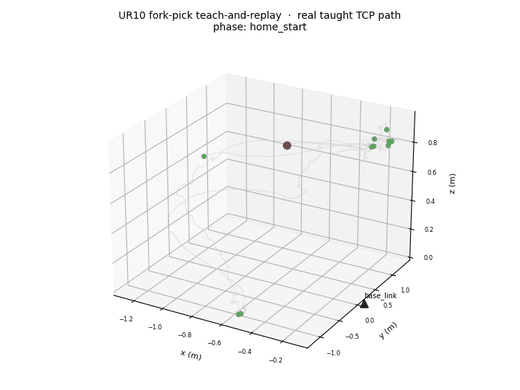
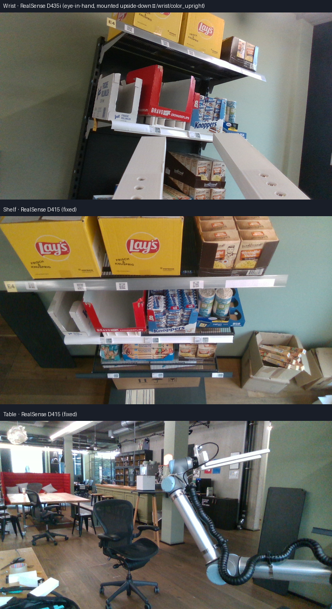
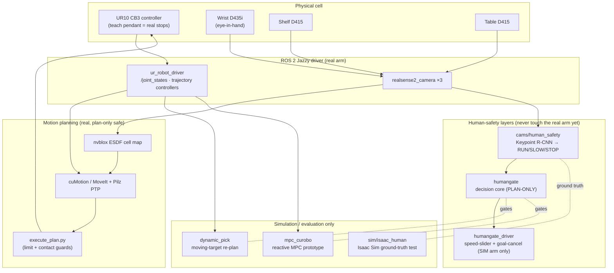
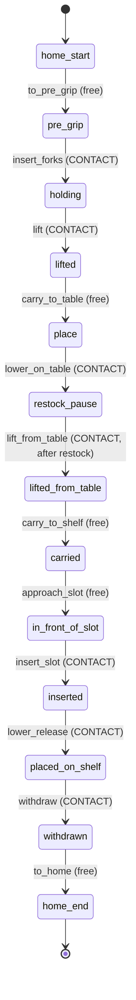
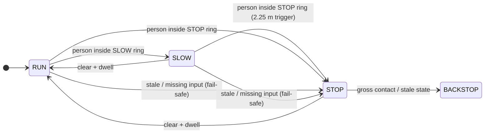

# UR10 Cell — real-robot ROS 2 stack, human-safety perception, and motion planning

This repository is the working software for a **Universal Robots UR10 (CB3)** arm set up as a
retail-shelf restocking cell: it brings the arm up on **ROS 2 Jazzy**, runs three Intel
RealSense cameras for mapping and human awareness, plans collision-free motion with NVIDIA
cuMotion, and carries a hand-loaded tray from a shelf to a table and back by
**teach-and-replay**. Everything here either runs on the real arm (driver bring-up, cell map,
calibration, the fork-pick demo) or is a **plan-only / simulation-only** layer around it
(human-safety gate, dynamic picking, MPC prototype, Isaac Sim test harness) that is deliberately
kept unable to touch the real robot until reviewed. The guiding rule throughout is *the map and
the cameras are a routing and awareness aid, never the certified stop* — the real stops stay on
the teach pendant.

> **New here?** Read this file top to bottom for the whole cell, then open the per-subsystem
> `README.md` linked under [Code structure](#code-structure) for depth. Day-to-day operator
> commands live in [`RUNBOOK.md`](RUNBOOK.md).

---

## Demo

A real **teach-and-replay fork pick**: an operator freedrives the arm through a tray-handling
cycle (approach → insert forks → lift → carry to table → set down for restock → pick back up →
carry to shelf → insert → release → withdraw → home), the path is recorded, segmented into
12 legs, and replayed under per-joint limit and contact guards. The animation below is the
**real taught tool-centre-point (TCP) path** from session `teach-002`, rendered straight from
the recorded joint/TCP log — not a mock-up. On that run the replayed tray landed within **~1 mm**
of the taught pose.



- **Full video (MP4):** [`docs/media/fork-pick-trajectory.mp4`](docs/media/fork-pick-trajectory.mp4)
- **How this media is made:** [`docs/media/gen_media.py`](docs/media/gen_media.py) regenerates
  the GIF, MP4, and camera composite directly from the teach records and camera stills — every
  frame is derived from on-robot data.

### The real cell, through its three cameras

The cell has one eye-in-hand camera on the wrist and two fixed cameras watching the shelf and the
table. These are the actual colour frames used by the cell map and the human-safety layer:



---

## What's inside

### Robot and hardware

| Piece | Detail |
|---|---|
| Arm | Universal Robots **UR10**, **CB3** controller, PolyScope **3.15.8**, direct-cabled to the workstation |
| Cameras | 3× Intel RealSense — **D435i** on the wrist (eye-in-hand, mounted **upside-down**), **D415** on the shelf, **D415** on the table |
| Contact sensing | CB3 has **no wrist force/torque sensor** — contact force is *estimated* from joint currents (coarse, ~152 N clean-motion swing) |
| GPU | Single 12 GB NVIDIA card, shared by cuMotion, the detector, and Isaac Sim |

### Software stack and versions

| Layer | Technology | Version |
|---|---|---|
| OS / middleware | Ubuntu 24.04 (Noble), **ROS 2 Jazzy**, Fast DDS (`FASTDDS_BUILTIN_TRANSPORTS=UDPv4`) | — |
| Robot driver | `ur_robot_driver` (`ros-jazzy-ur` stack, pinned to packages.ros.org) | **3.8.0** |
| Cameras | `realsense2_camera` (RealSense ROS 2 wrapper) | — |
| Motion planning (cell) | NVIDIA **Isaac ROS cuMotion** + MoveIt (`ur_moveit_config`), Pilz PTP for joint goals | MoveIt cfg 3.8.0 |
| Collision map | **nvblox** ESDF (static cell snapshot + an optional dynamic layer) | nvblox_ros **4.4.0** |
| Human detection | **Keypoint R-CNN** (torchvision), run on GPU in a user venv | torch 2.9.0+cu130, torchvision 0.24.0 |
| Reactive-MPC prototype | **cuRobo V2** (Apache-2.0, MPC-capable) in its own CUDA 12.6 + ROS 2 Humble container | cuRobo **v0.8.0** |
| Simulators | **Isaac Sim** (RTX render + Kit, WebRTC livestream), **URSim** (CB3), and GPU-free analytic mocks | — |
| Calibration | AprilTag colour-PnP (fixed cameras) + wrist hand-eye | — |

### Models and data

- **Keypoint R-CNN** person detector (torchvision pretrained) — the only learned model in the
  loop; used by `cams/human_safety` for human detection/pose. People are detected, tracked, and
  turned into a RUN/SLOW/STOP safety state; the model is **not** a certified safety function.
- **nvblox cell map** — a committed static ESDF snapshot of the cell (`cumotion/maps/`, large
  maps live on the host) that cuMotion plans against. A one-voxel map defect that blocked
  planning from the park pose, and its fix, are documented in `data/planner-map-fix-v1/`.
- **Measured joint limits** (`cumotion/measured_joint_limits.yaml`) — real travel windows swept
  by hand on the physical arm; every executed plan is checked against them.
- **Teach-and-replay records** — recorded TCP/joint logs, labelled waypoints, and per-leg plans
  that drive the demo above (operator-local, not committed; see
  [`fork_demo/`](fork_demo/README.md)).

---

## How it works

### Architecture



The one load-bearing idea: **the only thing that drives the real arm is the driver's trajectory
controllers, reached through `execute_plan.py` with limit + contact guards.** Every perception
and safety layer in this repo is wired so it *cannot* command the real robot until a human
reviews and arms it — enforced in code (e.g. `humangate/test_no_driver_interface.py` proves the
decision core imports no driver interface; `humangate_driver/arming_interlock.py` refuses the
real robot by IP/domain config).

### Mission: the teach-and-replay fork pick

The demo cycle is 12 segments. Free legs run at 10% speed; contact legs (forks into a tray,
lifts, releases) run at 5% with a contact guard. This is the actual segment list from
`replay_plan.json`:



### Human-safety decision state

The camera-side layer fuses detections into one fail-toward-STOP state. The robot-side gate
(`humangate`) consumes that state and decides what it *would* command — always biased to stop:



Zones: a **2.0 m protective ring** (`reach_radius + stop_radius`) with the STOP *trigger* pulled
out to **2.25 m** by a named `stop_margin: 0.25` after an Isaac-Sim test found the published
clearance over-stated distance in the unsafe direction (see
[Results](#results-and-known-limitations)). Full design and the provisional latency/zone figures
are referenced from `cams/human_safety/README.md`.

More diagrams and the full data-flow narrative: [`docs/architecture.md`](docs/architecture.md).

---

## Code structure

Each top-level directory is a self-contained subsystem with its own `README.md`. One line each:

```
ur10-setup/
├── README.md                 ← this file (whole-cell overview)
├── RUNBOOK.md                operator commands, health checks, recovery (authoritative day-to-day)
├── AGENTS.md                 project memory: build/test/architecture sharp-edge notes
├── ur-bringup.sh             launch the UR driver (ur_control.launch.py, headless)
├── install-ur-driver.sh      pinned apt install (defeats the Isaac-repo 99.x version override)
├── ur-detect.sh              ping + dashboard probe; detect CB3 vs e-Series
├── ur-rearm-watchdog.sh      re-assert the control program after a network blip
├── motion_test.py            self-verifying ±0.05 rad motion check
├── nudge_wrist3.py           first-light ±0.10 rad motion script
├── ur10_calibration.yaml     this arm's extracted factory kinematics
│
├── fork_demo/                real-arm scripted fork tray-pick demo (plan-only by default)
│   ├── fork_pick_demo.py       base_link TCP cycle; execute path has a typed-confirm gate
│   └── check_joint_feed_live.py  jitter gate: flags a frozen re-published joint feed
│
├── cams/                     cameras: bring-up, cell mapping, calibration, human perception
│   ├── README.md               camera bring-up sharp edges (serials, upside-down wrist, USB)
│   ├── approach/               seeded-IK approach demo (predictable motion vs MoveIt sampling)
│   ├── cellmap/                nvblox mapping, AprilTag calibration, plan/execute tooling
│   │   ├── calibrate_static_camera.py   fixed-camera → base_link (AprilTag colour-PnP)
│   │   ├── dynamic/            nvblox dynamic ESDF layer feeding cuMotion (sim-only)
│   │   └── tools/              execute_plan.py, loop_tags.py, map_ctl.py, record_joint_limits.py …
│   └── human_safety/           camera-side human detection + RUN/SLOW/STOP state (perception only)
│       ├── human_safety/         pure decision logic (geometry, tracker, SafetyEvaluator)
│       └── nodes/                thin ROS shells: detector_node, fusion_node, viz_node, shared_detector_node
│
├── cumotion/                 measured joint limits, limited-URDF builder, collision-force config
├── humangate/                robot-side safety gate — decision core, PLAN-ONLY (no driver import)
├── humangate_driver/         driver-backed gate (SIMULATED arm only): speed-slider + goal-cancel
├── dynamic_pick/             moving-target picking via segmented cuMotion re-plan (sim only)
├── mpc_curobo/               cuRobo V2 reactive-MPC planner prototype (sim/eval only, own container)
├── sim/isaac_human/          Isaac Sim ground-truth test harness for the human-safety graph
├── moveit/ · rviz/           MoveIt launch bits and RViz configs
└── data/                     per-task decision/report records (the "why" behind each change)
```

A longer walk-through, including the key scripts in each package, is in
[`docs/code-structure.md`](docs/code-structure.md).

---

## How to run

> **Safety first.** Nothing here moves the real arm unless you explicitly arm it. Plan-only
> (`plan_only=True`) and the simulation layers are always safe. The real stops are the teach
> pendant's safety-rated Force limit and any safeguard device — not this software.

### 1. Install the driver

```bash
./install-ur-driver.sh        # pinned apt install of the ros-jazzy-ur 3.8.0 stack
```

The pin (`/etc/apt/preferences.d/99-ur-from-ros2.pref`) is essential: the NVIDIA Isaac apt repo
otherwise overrides most `ros-jazzy-ur*` packages with a fake `99.2.0` while leaving
`ur-description` upstream, mixing incompatible halves.

### 2. Bring the arm up

The driver runs as a transient systemd **user** service so it survives terminal sessions:

```bash
systemd-run --user --unit=ur10-driver -p Restart=on-failure -p RestartSec=5 ./ur-bringup.sh
systemctl --user status ur10-driver        # health
journalctl --user -u ur10-driver -f        # live logs
```

`ur-bringup.sh` launches `ur_control.launch.py` headless (no pendant URCap needed). The robot
sits on a direct ethernet cable at the standard UR address `192.168.0.1`, the PC at
`192.168.0.2` — test the link with `ping -I <iface> 192.168.0.1` (a plain `ping` can
false-positive through other networks).

### 3. Verify motion

```bash
source /opt/ros/jazzy/setup.bash
python3 nudge_wrist3.py        # rotate wrist_3 ±0.1 rad and back (first-light check)
python3 motion_test.py         # self-verifying ±0.05 rad move, asserts return < 0.005 rad
```

Expected: `error_code=0` and sub-millidegree return repeatability. The speed slider must be
nonzero (pendant, or `set_speed_slider` service).

### 4. Run the fork-pick demo (plan-only)

```bash
python3 fork_demo/fork_pick_demo.py --dry-run     # prints/plots the base_link TCP cycle, no motion
```

The execute path refuses to move unless **all** of: `--i-am-at-the-estop`, a typed `EXECUTE`
confirm, the controller in RUNNING/NORMAL with External Control up, a motion controller active,
a live `/joint_states`, and every waypoint inside `measured_joint_limits.yaml`. See
[`fork_demo/README.md`](fork_demo/README.md).

### 5. Simulation layers (no real arm)

Each runs on its own isolated `ROS_DOMAIN_ID` so it can never reach the cell (domain 0). For
example the Isaac Sim human-safety test:

```bash
sim/isaac_human/run_boot_smoke.sh      # boot smoke test first
sim/isaac_human/run_session.sh         # full ground-truth run (single camera default)
```

See each package's `README.md` for its domain, container, and exact commands.

Day-to-day operator procedures (controller recovery, camera rig bring-up, cuMotion map loading,
freedrive, joint-limit re-measurement) are in **[`RUNBOOK.md`](RUNBOOK.md)**.

---

## Results and known limitations

**What works on the real arm**

- Driver bring-up, motion verification, and calibration restore are repeatable (first light
  2026-08-13; return repeatability ~8e-5 rad).
- The teach-and-replay fork pick completed a full shelf → table → shelf tray cycle with a
  hand-loaded tray, replaying within **~1 mm** of the taught pose.
- cuMotion plans collision-free motion against the nvblox cell map; a one-voxel map defect that
  blocked planning from the park pose was found and corrected
  (`data/planner-map-fix-v1/`).

**What is deliberately not live**

- **Human-safety is awareness, not a certified safety function.** All three cameras are
  presence-only until calibrated to `base_link`; as of the last calibration pass neither fixed
  D415 saw a mapped tag, so both stay presence-only (`data/human-cam-calib-v1/`).
- An Isaac-Sim ground-truth test surfaced a real detection bug: the published STOP-ring distance
  over-stated clearance by **+0.4–0.9 m in the unsafe direction** because the zone was sized from
  the body *centre* (dragged back by the clean sim floor) instead of the nearest body point. The
  production layer was fixed to react to the nearest credible point, and a `stop_margin: 0.25`
  pushes the STOP trigger to 2.25 m; the missed-STOP interval on the committed fixture dropped
  0.90 s → 0.00 s (`data/human-safety-nearest-point-fix-v1/`,
  `data/human-safety-stop-margin-v1/`).
- The **driver-backed gate, dynamic picking, and cuRobo MPC** are simulation/eval only, on
  isolated ROS domains, and refuse the real robot by config. Real-arm arming is a later,
  reviewed change.
- CB3 has **no F/T sensor**: ROS-side contact sensing is tracking-error-based, a coarse backstop;
  the real force limit is pendant-only (`data/collision-force-v1/`).
- GPU is shared: 2+ cameras in the Isaac human-safety sim push latency past the reaction budget,
  so that harness defaults to a single camera.

The `data/` directory holds a decision/report record for each of these — the authoritative "why"
behind every tuning choice.

---

## Licence and attribution

- **Licence: the repository owner's call.** No licence has been chosen for this repository yet,
  so no `LICENSE` file is added here. Until one is added, default copyright applies (all rights
  reserved). *Repository owner's decision required.*
- **Third-party components** carry their own licences and are not vendored here: ROS 2 and the
  Universal Robots ROS 2 driver (Apache-2.0/BSD), NVIDIA Isaac ROS / cuMotion / nvblox and Isaac
  Sim (NVIDIA licences), **cuRobo V2 v0.8.0 (Apache-2.0** — note v1/`0.7.x` is NVIDIA
  non-commercial; this repo pins v0.8.0 and keeps it out of any shipped dependency pending an
  owner decision, `data/plan-mpc-curobo-v1/`), torchvision models (BSD), and MoveIt (BSD).
- Robot: Universal Robots UR10. RealSense: Intel. These are referenced, not redistributed.
