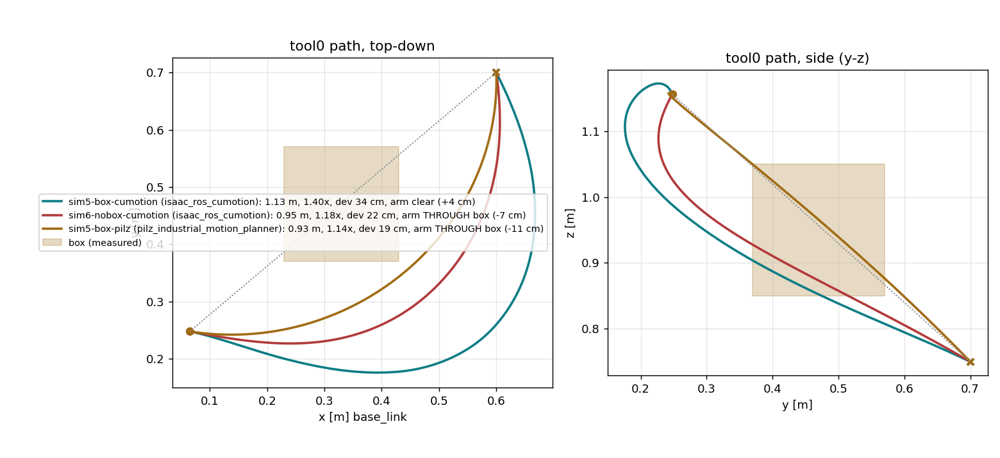

# cams/cellmap — handheld 3-D obstacle map of the cell for cuMotion (v1)

The D435i comes off the arm, the captain walks the cell with it, cuVSLAM
poses the camera, nvblox fuses the depth into a 2 cm ESDF **in `base_link`**
(anchored by an AprilTag the arm measured by touch), the map is saved once,
and every later session cuMotion plans against it. Design decision and option
comparison: firstmate's `cell-map-slam.html` (2026-08-26). This README is the
"why" and the procedure; the recurring commands are in `RUNBOOK.md` §10.

Status 2026-08-26: pipeline built and **bench-rehearsed end to end on
synthetic depth** (no camera, no arm motion — `bench/`); the physical steps
(tracking loop, tag corners, scan walks) are the captain's and are recorded
in `cellmap-report.html` as they happen.

## Pieces

| File | Runs where | Does |
|---|---|---|
| `run_scan.sh` → `scan.launch.py` | Isaac container `ur10-cellmap-scan`, domain 0 | D435i (RGBD profile) + cuVSLAM RGBD; optional robot segmenter + nvblox (`segmenter:=true nvblox:=true`) |
| `nvblox_cell.yaml` | container | nvblox deltas vs NVIDIA's manipulator config (2 cm, `base_link`, workspace box, no decay) |
| `scan_session.sh` | host | anchor → mapper stage → Enter → `save_map`; enforces the anchor-before-integrate order |
| `tools/make_tags.py` → `tags/` | host | print-exact AprilTag 36h11 sheets (120 mm, corner labels, 100 mm ruler) |
| `tools/tag_corners.py` | host | arm-measured tag pose: dwell-detects the tip at corners A,B,C → `anchor/tag<id>.yaml` |
| `tools/tag_anchor.py` | host | detects the tag in the handheld stream, publishes static `base_link → map`, prints the live residual |
| `tools/loop_check.py` | container | tracking-loop evidence: closure error, gaps, plot |
| `tools/map_ctl.py` | container | `save` / `load` / `ply` / `esdf` (probe columns, sphere clearances) |
| `run_rviz.sh` → `cellmap.rviz` | container on the workstation display | RViz **with the nvblox plugin** (host RViz cannot decode `nvblox_msgs/Mesh`) |
| `planner.launch.py` | container `ur10-cumotion` | nvblox (serves the saved map, no camera) → `load_map` → cuMotion `read_esdf_world:=true` |
| `../../cumotion/start_cumotion_map.sh` | host | opt-in sibling of `start_cumotion.sh`; picks the newest `cell-*.nvblx` |
| `../../cumotion/ur10_map.xrdf` | container | world buffers 0.04 m on forearm/wrists/tool (0.02 kept on shoulder/upper arm — see below) |
| `tools/plan_test.py` | host | plan-only A→B (joint or **pose** goal), FK tool path, arm-sweep clearance vs a box, plots |
| `tools/fake_depth.py` | host | synthetic depth camera + TF for the bench rehearsal |

## Frame chain (the thing everything hinges on)

```
world → base_link → map → odom → camera_link → camera_color_optical_frame
        (robot)     ↑static      (cuVSLAM)      (RealSense static)
                    tools/tag_anchor.py  =  T_base_tag · (T_map_cam · T_cam_tag)⁻¹
```

* `base_link → map` is published ONCE per scan session, from the arm-measured
  tag pose (`T_base_tag`) and the tag seen by the handheld camera through
  cuVSLAM's pose. nvblox and the segmenter look up
  `base_link → camera_color_optical_frame` through that chain, so the map is
  built directly in the planner's frame — no registration at load time.
* **The anchor must exist before nvblox starts.** Frames integrated before it
  land in a wrong frame and cannot be un-integrated; `scan_session.sh`
  refuses to start the mapper stage until the anchor yaml exists.
* Nothing from the rigs may be published while the camera is in hand:
  `tool0 → camera_link` (`approach/wrist_rig.launch.py`) would give
  `camera_link` two parents; `world → PerceptionCamera` (`rig.launch.py`) is
  the table-rig pose. `run_scan.sh` refuses to start while a host
  `realsense2_camera_node` holds the device (`pgrep -af realsense2_camera_node`).
* The pendant's TCP readout is in UR's `base` frame, which ur_description
  rotates **180° about Z** relative to `base_link` (verified live:
  `tf2_echo base_link base` = yaw 180°), and this robot's active TCP is
  ~0.5 m off the flange. `tag_corners.py` therefore reads TF, not the pendant
  (`--pendant` converts through the same live TF if you want the cross-check).

## Design decisions (dated 2026-08-26 unless noted)

**cuVSLAM in RGBD mode, projector ON.** NVIDIA's stereo-IR+IMU demo flashes
the emitter and needs `realsense_splitter` (not in the image) plus per-frame
emitter metadata that firmware 5.12.8.200 may not emit (Isaac asks for
5.16.0.1). RGBD tracks on colour + aligned depth and needs none of that. The
price is **no IMU fusion** and a rolling-shutter colour sensor: walking pace,
no fast turns, keep textured objects in view. Stereo+IMU remains the fallback
(firmware flash = captain decision, splitter = source build) only if step 1
shows RGBD tracking is unusable.

**Camera driver inside the container, USB passed through.** Same librealsense
build Isaac was tested with, NVIDIA's exact topic/frame layout, and no DDS hop
for 640×360 colour+depth at 30 Hz. `/dev/bus/usb` + a cgroup rule for USB
char-major 189 is all the RSUSB backend needs — no `--privileged`, no udev in
the container (the host node is already 0666/plugdev). `serial_no` is not
pinned (one camera; the launch-arg path types it as a double — `cams/README.md`).

**2 cm voxels, `base_link`, bounding box = reach + 0.5 m, y to +2.4.** 1 cm
(NVIDIA's manipulator default) is ~8× the memory for a map whose registration
error is itself 1–2 cm. The box (`nvblox_cell.yaml`) is the UR10 reach
envelope plus margin, extended to y 2.4 so the gondola front is mapped even
where the arm cannot reach it — a plan may still sweep the wrist toward it.
Decay and radius-clearing are OFF (the manipulator config expects a fixed
camera and a moving scene; for a snapshot they would erase the far side of
the cell while the captain walks). Max integration range 3 m: D435i depth
noise grows ~quadratically, so far walls would enter the ESDF as mush.
`projective_integrator_max_weight` 20 instead of 5: a snapshot wants noise
averaging over many viewpoints, not reactivity.

**Robot segmenter with a 0.10 m buffer.** Without it the parked arm maps
itself and the first plan from the park pose fails as "start in collision".
The buffer is wide because the handheld pose is a cm-level SLAM estimate, not
FK. The masked region stays *unobserved*, which cuMotion treats as **free**
(bench-verified: planning from the park pose succeeded on a map whose park
region was never observed) — so the halo costs nothing.

**Unobserved = free** (bench finding, `map_ctl.py esdf` shows the −1000
sentinel). Consequence: the map only protects against what the camera SAW.
Walk every surface the arm can reach; unscanned obstacles are invisible to
the planner exactly as before the map. The ground plane and the approach
demo's whitelist boxes stay on as independent guards.

**Buffers: 0.04 m on forearm/wrist_1/2/3/tool0, 0.02 kept on
shoulder/upper_arm.** The extra 2 cm absorbs the map error budget. It cannot
be applied to the upper arm: its root sphere (r 0.09) sits 3.8 cm above the
mounting plane — 1.8 cm clear of cuMotion's ground plane at 0.02, *inside* it
at 0.04, and every start state then fails with
`INVALID_INITIAL_CSPACE_POSITION` (found in the bench rehearsal). Those links
never leave the base region anyway.

**Load-then-plan, gated on the loader's exit code.** cuMotion with
`read_esdf_world:=true` blocks forever if the ESDF service is absent
(`start_cumotion.sh`'s warning), and an nvblox that is up but EMPTY makes
`World update failed` on every request — a planner that looks alive and
refuses everything. `planner.launch.py` starts cuMotion only after
`map_ctl.py load` returns 0, else shuts the launch down loudly. Same container
name as the default planner (`ur10-cumotion`), so docker refuses to run both
(they would both answer `cumotion/move_group`).

**Pose goals for collision-aware IK.** With a map, a joint-space goal
pre-solved by MoveIt's `/compute_ik` (empty scene) can be in collision for
cuMotion — bench: the goal's forearm ran 1–9 cm into the box and trajopt
failed with `UNKNOWN_STATUS`. A tool0 *pose* goal lets cuMotion pick the
configuration against its own world. `plan_test.py --pose-goal`; chain
`--start-from <label>` to start a leg from a configuration cuMotion itself
found valid. The approach demo's 170° rewind guard is re-applied to every
returned trajectory.

## Bench rehearsal (2026-08-26, synthetic depth, arm never moved)

`tools/fake_depth.py` rendered a table plane, a shelf slab at y 1.4 and a
20 cm cube at the midpoint of park → (0.60, 0.70, 0.75), and published the
camera TF directly; the real nvblox/cuMotion stack did the rest.

| plan | planner | tool path | max dev. from line | arm vs box (spheres + buffer) |
|---|---|---|---|---|
| `sim5-box-cumotion` | cuMotion + map, pose goal | 1.13 m (1.40×) | 34 cm | **clear, +3.5 cm** |
| `sim5-box-pilz` | Pilz PTP (no map) | 0.93 m (1.14×) | 19 cm | **through, −11 cm** |
| `sim6-nobox-cumotion` | cuMotion + map, box removed & re-scanned | 0.95 m (1.18×) | 22 cm | through the *former* box volume, −6.7 cm → detour gone |



Also verified: `save_map`/`load_map` round trip (19–33 MB per synthetic map),
ESDF hand-off (`Initialized grid from nvblox: 193×217×121 @ 0.02 m`),
planning 0.1–0.13 s, ESDF zero-crossing at the table surface within a voxel
(`map_ctl.py esdf --probe`). Plans and numbers: `plans/sim*.yaml`.

## Procedure

Safety: no arm motion in steps 1–3 except freedrive; e-stop within reach
whenever the arm is powered; one writer at a time (RUNBOOK §6b).

### 0. Camera off the arm
1. Unstrap the D435i from the flange; keep it on the USB 3 cable.
2. Stop whatever holds it: `pkill -f wrist_rig.launch.py` (and the tray rig
   if it was on the table). `pgrep -af realsense2_camera_node` must be empty.
3. Print `tags/apriltag36h11-id0-120mm.pdf` and `id1` at **100 %** (the 100 mm
   ruler must measure 100 mm), mount on rigid board, tape tag 0 flat on the
   table inside reach, tag 1 ~0.5 m away, also in reach. Both must stay put
   for the whole session.

### 1. Tracking proof (no arm)
```bash
cams/cellmap/run_scan.sh                       # camera + cuVSLAM RGBD
cams/cellmap/run_rviz.sh                       # path + landmarks on the display
docker exec -it ur10-cellmap-scan bash -lc 'source /opt/ros/jazzy/setup.bash && python3 /cellmap/tools/loop_check.py --out /maps/loop-$(date +%F)'
```
Rest the camera on a marked spot, walk a slow loop of the cell, put it back
on the same spot, hold 3 s, Ctrl-C. Good: closure < 5 cm, no gaps > 0.5 s,
no jumps; the RViz path is a closed loop. Bad: jumps or a path that does not
close → shorter loop, slower, more texture in view; if it still fails, the
stereo+IMU fallback is a captain decision.

### 2. Anchor (freedrive only)
```bash
FASTDDS_BUILTIN_TRANSPORTS=UDPv4 python3 cams/cellmap/tools/tag_corners.py --tags 0 1
```
Freedrive the tip to corner **A, B, C** of tag 0 (labels on the sheet), then
of tag 1, holding still ~3 s on each. The tool captures each dwell, checks
|AB| = |BC| = 120 ± 4 mm and angle 90 ± 1°, writes `anchor/tag0.yaml`,
`anchor/tag1.yaml`. Tip: `--tip tcp` (pendant TCP = the physical tip, default)
or `--tip tool0 --tip-offset x,y,z`. Sanity check after the anchor is up
(step 3): `tag_anchor.py --tag anchor/tag1.yaml --check-only` must land
tag 1 within 2 cm of its arm-measured pose.

### 3. Scan and save
```bash
cams/cellmap/scan_session.sh cams/cellmap/anchor/tag0.yaml cell-$(date +%F)
```
Point the camera at tag 0 (0.5–1 m) until "anchor published", then walk:
table from three sides, every shelf face, walls within reach, low and high
angles, 0.3–2 m from surfaces, and finish on tag 0 (the residual printed by
`tag_anchor.py` at that moment is the map's registration error). Enter →
`save_map`. Verify in `run_rviz.sh`: table height, shelf x/y against the
approach demo's measured front face (y ≈ 1.52 at x ≈ 0), arm absent.
Maps: `cumotion/maps/` if < 50 MB (committed), else `~/ur10/cumotion/maps/`.

### 4. Plan with the map
```bash
systemctl --user stop ur10-cumotion; docker stop ur10-cumotion   # the unit stop alone can orphan the container
cumotion/start_cumotion_map.sh                                   # newest cell-*.nvblx, voxels:=true
FASTDDS_BUILTIN_TRANSPORTS=UDPv4 python3 cams/cellmap/tools/plan_test.py --label with-box --goal-pose X,Y,Z --pose-goal
```
Acceptance: a cardboard box scanned on the straight line between the park
pose and the goal → the plan routes around it (arm-sweep clearance ≥ 0 via
`--recheck --check-box`); box removed + re-scan → the plan straightens.
Execution stays captain-confirmed (approach demo rules, ≤ 0.05 scaling).

## Known limitations (v1)

- **Snapshot map.** Anything moved after the scan is invisible to the planner
  until re-scanned; unobserved space is free. Re-scan after moving anything
  the arm can reach; the whitelist boxes and ground plane stay on.
- **No IMU in RGBD mode**, rolling-shutter colour: fast rotation or a
  featureless wall can lose tracking. Restart the scan rather than trust a
  re-localised segment.
- **Registration error** ≈ tag pose (mm) + PnP (≈1° at 1 m ≈ 2 cm) + drift
  after loop closure; the 0.04 buffer absorbs it, thin objects may not.
- **Min range ~17 cm**, 2 cm voxels: cables and shelf lips can vanish.
- **Version drift**: Isaac 4.x pins librealsense 2.56.3 / fw 5.16.0.1; this
  box runs 2.58.1 / 5.12.8.200. RGBD mode is the least sensitive path; if
  step 1 misbehaves, versions are the first suspect.
- **Planner swap is manual**: default and map planners share the container
  name; `systemctl --user stop ur10-cumotion` can leave the container running
  (observed 2026-08-26, "Up 12 days" after the unit failed) — `docker stop`.

## Future work (out of scope for v1)

Phase 2 = live refresh from the wrist camera after hand-eye calibration:
same nvblox node, same cuMotion switch, pose from FK instead of cuVSLAM,
integrating on top of the loaded scan. A second fixed camera (the tray rig)
would keep the table region live without re-walking the cell.
