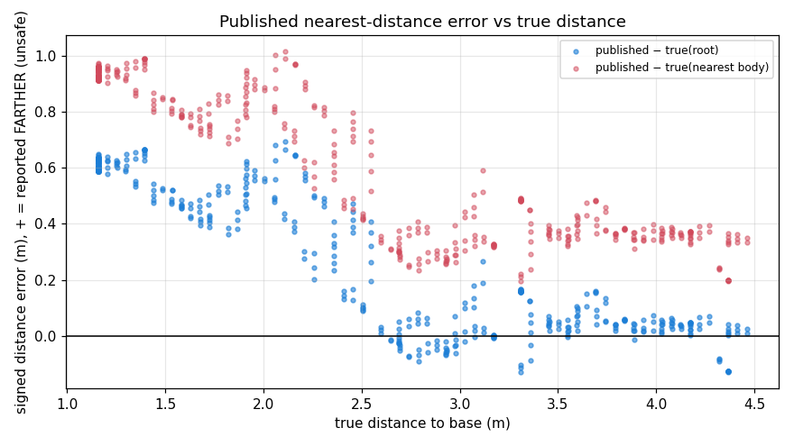
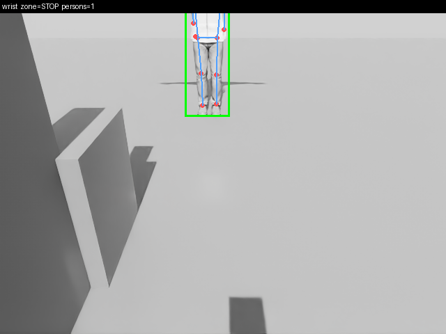
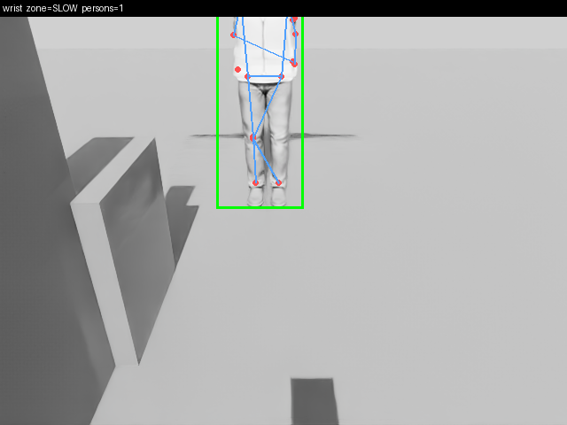
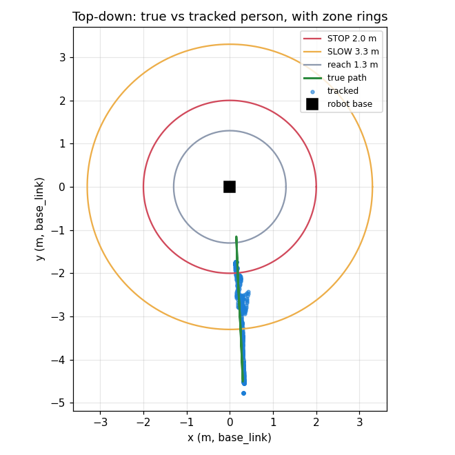
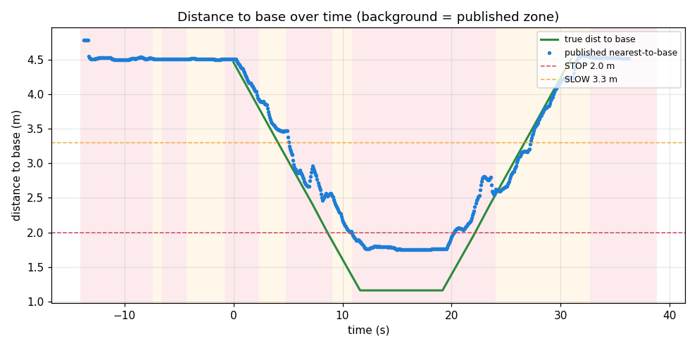

# Human-detection in Isaac Sim — test report

**❌ FAIL — read this first**

> FAIL: 1 missed-STOP interval(s); the person's nearest true body point reached 1.06 m from base (0.94 m inside the 2.00 m STOP ring) while the state was not STOP, for up to 1.73 s (> the reaction budget).

## In plain words

- **Does it see the person?** Yes — detection rate wrist 100% of the frames where the person is truly in view (score ~1.00).
- **Which way is the distance off, and how much?** The published distance reads the person **FARTHER** from the robot than they truly are (the unsafe direction) — by **+0.39 m (n=464)** versus the true root and **+0.71 m (n=464)** versus the nearest true body point.
- **At what true distance does STOP engage?** With a healthy (distance-driven) pipeline, STOP only engaged once the person's nearest body point was already **0.96 m inside** the 2.0 m ring (true nearest 1.04 m; the published distance still read ~2.0 m).
- **Bottom line:** the detector localises the person, but the published *distance* over-states clearance, so the STOP ring engages LATE. That is a missed-STOP window, not a missed detection.

## ❗ Missed STOP (safety-critical)

| # | duration (s) | closest true body point to base (m) | inside ring by (m) |
|---|---|---|---|
| 1 | 1.73 | 1.06 | 0.94 |

This is on the HEALTHY-latency run, so it is the distance bias (below), not a pipeline stall.

## Why: the STOP ring is sized from the depth-median body CENTRE

The bias is **not** a definition mismatch or a bad camera pose:

| truth reference | published − true (signed) |
|---|---|
| placed root (feet axis) | +0.39 m (n=464) |
| true body centroid | +0.42 m (n=464) |
| nearest true body point | +0.71 m (n=464) |

The error is positive against **all three** true references — the published distance is genuinely too large, not just measuring a different point. The cause is the depth lift:

_Per-camera split from the separate 2-camera run:_

| camera | body-centre error | nearest-point error | centre − nearest |
|---|---|---|---|
| shelf | +0.63 m (n=139) | +0.16 m (n=139) | +0.86 m (n=139) |
| wrist | +0.28 m (n=123) | +0.19 m (n=123) | +0.39 m (n=123) |

The detector's **nearest credible point is accurate** (~0.2 m of the true nearest body), but its **median body CENTRE sits 0.4–0.9 m farther back** — in clean sim depth the floor behind the person is fully sampled and drags the component-wise median into the background. The overhead **shelf** camera (which sees the most floor behind the person) is worse than the frontal **wrist** camera.

**The safety layer then sizes the STOP ring from that CENTRE, not the nearest point.** `cams/human_safety/human_safety/safety.py` line 83 computes the zone distance from `t.position` (the Kalman-filtered median centre); `t.nearest_point` — the closer, on-body point the detector already computes for exactly this purpose (README "nearest credible body point") — is carried on the track but never used for the zone. Using it would cut the unsafe bias from ~+0.7 m to ~+0.2 m.

The character's **T-pose** amplifies this: its image box is ~2.1 m wide (arms out) and mostly background, so the median is dominated by floor. A natural pose would narrow the box and reduce (not remove) the bias.

**Extrinsics are cleared** as the cause: the horizontal (x) position matches truth to a few cm, the recorded true world bounding box confirms where the body is, and the TF round-trip is unit-tested (`tests/test_sim_poses.py`). The error lives entirely on the depth (range) axis.

## Pipeline latency (this run is healthy)

- Image→state latency: median 0.34 s, p95 0.69 s; only 5% of states over the 0.70 s budget — so the SLOW/STOP changes above are **distance-driven**, not latency faults.
> Earlier 3-camera runs shared the one 12 GB GPU between Isaac's RTX renderer and the neural detector and ran the latency past the budget, pinning the state at STOP (fail-safe) and masking the distance logic. This healthy run uses a single camera to isolate the distance behaviour; the real rig measured ~0.26 s.

## Position & distance error vs ground truth

- Horizontal position error (nearest track vs true body centroid): median 0.42 m, p95 0.67 m, worst 0.73 m (n=464)
- Nearest-distance-to-base error: median 0.39 m, p95 0.64 m, worst 0.69 m (n=464) — **positive = the unsafe direction** (see above).

## Pictures — what the detector saw

Green box = detected person, red dots = keypoints, blue = skeleton. Two
representative frames are committed here (a STOP and a SLOW state); the full run
emits one per state message.

Top-down true vs tracked path, and distance-over-time with the published (biased) distance and zone bands:

## What was simulated vs simplified

- Cameras: 1 simulated RGB-D (wrist stand-in), 640×480, ~69° HFOV, exact base_link extrinsics.
- Robot + shelf + table: primitive box stand-ins.
- Person: one realistic Isaac People character, teleported in its default rest/T-pose (no walk cycle), always on the floor.
- Ground truth: 185 samples with the true world bounding box; 794 state messages.

## Follow-ups (not done here)

- **Production (human_safety):** size the STOP ring from the track's `nearest_point`, not its median `position` (`safety.py:83`). Documented here as a finding; NOT changed in this task. Would cut the unsafe bias from ~+0.7 m to ~+0.2 m.
- **Harness:** give the character a natural standing/walking pose (omni.anim.people) so its image box is body-filled, and re-run to measure the residual centre bias without the T-pose amplifier.
- Calibrate the fixed D415s and run the full multi-camera rig once the GPU budget allows a healthy pipeline with >1 camera.

## What this does NOT prove

- A rendered character is not a real person: appearance, pose and motion are synthetic, so neither a detection nor a miss here transfers directly to a real human.
- Isaac's simulated depth is far CLEANER than a RealSense stream (no holes, speckle, or range dropouts). Counter-intuitively this makes the bias below WORSE, not better: the clean floor behind the person is fully sampled and pulls the depth-median body centre into the background. Real depth noise and min/max-range dropouts would change the number, in either direction.
- The character is TELEPORTED in its default rest/T-pose (arms out, no walk cycle). The T-pose makes the image bounding box ~2 m wide and mostly background — this AMPLIFIES the centre bias. A natural standing/walking pose would shrink it (follow-up).
- The simulated cameras have exact, noise-free extrinsics; the real fixed D415s are uncalibrated today and stay presence-only until calibrated.
- This layer is NOT a certified safety function — a single-channel, unrated, supplementary awareness layer. The real protection is the robot's safety-rated protective stop (+ a recommended presence device). See cams/human_safety/README.md.
- Only the decision logic was exercised, unchanged. The sim config re-points topics/frames/poses + device; every safety radius, score threshold, dwell and budget is identical to production (enforced by tests/test_sim_config.py).

_Run id: run_20260921T082428Z_

_Regenerate with `python3 sim/isaac_human/make_report.py --run <run-dir> --out data/human-detect-isaac-sim-v1` (this committed copy keeps report.md + the three plots + two annotated frames; report.html, run logs and bags are intentionally not committed)._
