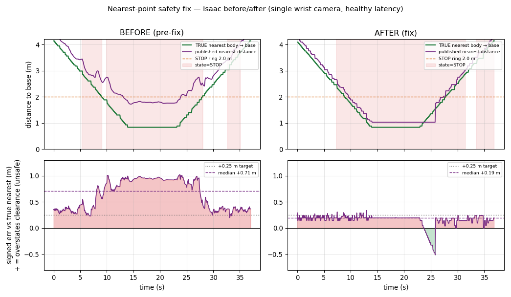
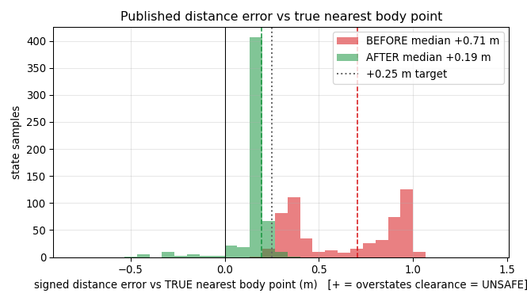

# Nearest-point safety fix — Isaac before/after

**✅ PASS — the missed STOP is gone, and the published distance no longer
over-states clearance.**

> The Isaac test in PR #22 (`data/human-detect-isaac-sim-v1/report.md`) FAILED: the
> camera safety layer saw the person on 100% of frames but published a distance
> that read the person **farther** from the robot than the truth, so STOP engaged
> late (a missed STOP). This task fixed the production layer and re-ran the SAME
> harness. On a controlled before/after (identical camera, path and settings, both
> healthy-latency), the fix removes the missed STOP and cuts the distance bias
> against the true nearest body point from **+0.71 m to +0.19 m (median)**.

## What was wrong, and what changed

Two independent causes, both in the production layer `cams/human_safety`, both fixed:

1. **The zone was sized from the body CENTRE, ignoring the nearer body point.**
   `safety.py` sized the STOP/SLOW ring from the Kalman-filtered body centre
   (`t.position`) and never used `t.nearest_point`. An outstretched hand inside the
   ring did not trigger STOP while the centre was still outside it. **Now** the zone
   distance is `min(centre, nearest)` — never larger than the centre — with the
   nearest-point *range* passed through a short robust filter
   (`NearestRangeFilter`) so a single-frame depth speckle cannot chatter STOP and a
   genuinely close reading still engages after two frames.
2. **The centre itself was dragged back by background depth.**
   `geometry.lift_depth` took the component-wise median over the whole person box,
   so floor/wall pixels inside the box (often >50% in clean sim depth) pulled the
   centre metres into the background. **Now** the centre is the median of the
   **foreground cluster only** (points within a body-depth band of the near
   surface).

The published JSON keeps every existing field; the pre-fix centre distances are
still published as `nearest_distance_centre` / `nearest_distance_base_centre` for
diagnostics. `humangate` / `humangate_driver` read only the existing fields and
their tests still pass.

## Before / after (controlled A/B, same harness settings)

Both runs: single wrist RGB-D camera, identical scripted path, Isaac domain 88,
detector on the shared 12 GB GPU. Both are **healthy-latency** (≈5% of states over
the 0.70 s reaction budget), so the SLOW/STOP changes are distance-driven, not
latency faults. Truth = the simulator's true world bounding box; "nearest body
point" = the nearest point of that box to the base z-axis.

| metric | BEFORE (pre-fix) | AFTER (fix) |
|---|---|---|
| **verdict** | ❌ FAIL | ✅ PASS |
| **missed STOPs** (person truly inside ring, state not STOP, > 0.7 s) | **1** (0.73 s; nearest body 0.29 m inside the ring) | **0** |
| signed distance error vs **true nearest body point**, median | **+0.71 m** | **+0.19 m** |
| … p95 (abs) / worst (most positive) | 0.97 / **+1.02 m** | 0.27 / **+0.34 m** |
| signed distance error vs **true root**, median | +0.38 m | −0.13 m |
| detection rate (wrist, in-view frames) | 100% | 100% (145/145) |
| STOP entry vs the true ring crossing | 0.05 s (at 1.99 m) | 0.03 s (at 1.99 m) |
| img→state latency, median / frac over 0.70 s | 0.39 s / 5.5% | 0.39 s / 4.6% |

Positive error = the published distance says the person is FARTHER than they truly
are (the unsafe direction). After the fix the median error against the true nearest
body point is **+0.19 m**, within the ~0.25 m target; the worst-case single sample
is +0.34 m (residual from the depth-median nearest estimate, itself ~0.2 m
accurate, plus the wide T-pose box — see "What this does not prove"). Against the
true root the after-fix distance is now slightly *negative* (reads nearer than the
root) — expected and safe, because it now reports the nearest body point, which is
closer than the root.





## Which fix did what (ablation on the after-run)

Replaying the after-run's recorded detections through the safety machine with the
old (centre) vs new (nearest) *zone rule* — geometry fix held constant
(`compare_fix.py`) — isolates the two fixes:

| pipeline | signed err vs true nearest, median |
|---|---|
| old geometry + centre rule (true BEFORE) | +0.71 m |
| **fixed geometry** + centre rule | +0.24 m |
| **fixed geometry + nearest rule** (AFTER) | +0.19 m |

The foreground-centre fix removes most of the bias (+0.71 → +0.24); the
nearest-point rule trims it further (+0.24 → +0.19) **and** adds the structural
guarantees the bias number cannot show: the zone can never read farther than the
centre, and it reacts to a hand thrust inside the ring.

## False-STOP / chatter check (no new chatter)

The fix must not turn into constant STOP flicker. Two checks:

- **In-repo replay fixture** (`cams/human_safety/tests/data/synthetic_approach.jsonl`,
  the only recorded replay log in the repo; the real-rig walk-through needs the
  owner and has not been captured — all cameras are presence-only on the live rig).
  Old logic vs new logic: **zone changes 4 → 4** (no new chatter); total STOP time
  4.80 s → 5.10 s (the nearest-range filter's slow-away holds STOP ~0.3 s longer on
  retreat — conservative, fail-toward-STOP). Here `nearest == centre` every frame,
  so this isolates that the *rule* adds no chatter of its own.
- **After-run rule ablation** (`compare_fix.py`, real detector-driven data): old
  rule vs new rule **zone changes 10 → 10**, STOP time 44.7 s → 44.7 s — no chatter
  increase; where the two differ the new rule only adds STOP.

## What this does NOT prove

- A rendered character is not a real person; Isaac's simulated depth is far cleaner
  than a RealSense stream (no holes/speckle/range dropouts). Counter-intuitively the
  clean floor makes the *centre* bias the fix targets **worse**, not better, so this
  is a conservative test of the geometry fix; real depth noise would move the number
  either way.
- The character is teleported in its default **T-pose** (arms out, ~2 m-wide,
  background-heavy box). This maximises the centre bias, so passing here is the
  harder case — but it is not a natural pose. Giving it a body-filled standing/walking
  pose needs `omni.anim.people` (a skeletal animation graph), which is **not** a
  low-cost swap on this single-12 GB-GPU harness (the RTX renderer already shares the
  card), so it stays a follow-up. The residual worst-case +0.34 m is partly this box.
- Single wrist camera only (the healthy-latency set on the shared GPU). The
  fixed D415s are uncalibrated and presence-only until a separate task calibrates
  them; a multi-camera healthy run needs more GPU headroom.
- This layer is **NOT a certified safety function** — a single-channel, unrated,
  supplementary awareness layer. The real protection is the robot's safety-rated
  protective stop (+ a recommended presence device). See
  `cams/human_safety/README.md`.
- Only perception-side distance logic changed. No robot interface, no threshold /
  radius / dwell / budget change; the sim config's safety block is still byte-verbatim
  the production block (enforced by `sim/isaac_human/tests/test_sim_config.py`).

## Reproduce

```bash
# after-run (fixed code) and before-run (git checkout the pre-fix code first):
sim/isaac_human/run_session.sh wrist cuda          # -> RUNDIR
python3 sim/isaac_human/analyze.py --run "$RUNDIR" \
    --config sim/isaac_human/params/human_safety.sim.yaml
python3 sim/isaac_human/compare_fix.py --run "$RUNDIR"   # old-vs-new from one run
```

_After-run id `run_20260921T101304Z`, before-run id `run_20260921T101648Z`
(single wrist camera, cuda). Committed here: report.md + the two plots; report.html,
run logs, bags and frames are intentionally not committed._
