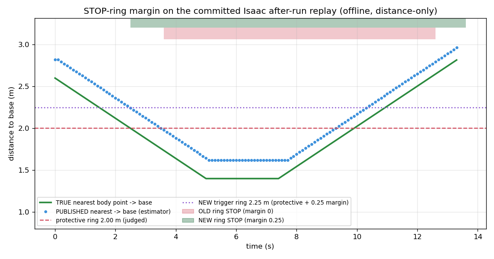

# STOP-ring margin for the camera human-safety layer

**Task:** human-safety-stop-margin-v1 · **Date:** 2026-09-21 · **Branch:** `fm/human-safety-stop-margin-v1`
**Owner ask (verbatim, 2026-09-21):** "increase the stop ring margin"

## Verdict (plain words)

**Done, and it works on the committed offline replay.** The camera human-safety
layer (`cams/human_safety`) now commands STOP **0.25 m earlier** — at **2.25 m of
the robot base** instead of 2.0 m. The 2.0 m *protective* ring is unchanged; the
extra 0.25 m is a separate, named **estimator margin** that covers the nearest-point
estimator's measured tendency to report a person slightly **farther** than they
really are (the unsafe direction).

Replaying the committed Isaac after-run fixture through the real safety state
machine (offline, no simulator, no GPU), judged against the **true 2.0 m protective
ring**:

| metric (distance-only, latency fault off) | OLD ring (margin 0, trigger 2.00 m) | NEW ring (margin 0.25, trigger 2.25 m) |
|---|---|---|
| **missed-STOP interval** (person truly inside 2.0 m, state not STOP) | **0.90 s** ❌ (over the 0.70 s budget) | **0.00 s** ✅ |
| true nearest-body distance when STOP engages | 1.76 m (0.24 m **inside** the ring) | 2.00 m (**at** the ring) |
| zone changes | 4 | 3 (does **not** increase) |
| total STOP time | 9.0 s | 11.1 s (never shorter) |
| verdict | FAIL | **PASS (safety-critical)** |

The missed-STOP interval falls from **0.90 s to 0.00 s** — inside the 0.70 s
reaction budget, and in fact zero on this fixture. The person is no longer inside
the 2.0 m protective ring without STOP for longer than the budget. **The margin is
sufficient; no `needs-decision` escalation.**

(The task brief quotes the pre-existing figure as ~0.93 s late / 0.25 m inside from
`data/human-safety-nearest-point-fix-v1/report.md`. On this committed fixture the
old-ring residual measures 0.90 s / 0.24 m — the same story, the small difference
is the scripted fixture vs. the original run. The regression test ceiling for the
new ring is tightened to the 0.70 s reaction budget.)

## What changed

The protective distance and the estimator margin are kept **distinguishable** in
config and code:

- `cams/human_safety` — new `SafetyParams.stop_margin` (config key `stop_margin: 0.25`),
  added to the STOP **trigger** only via the `stop_trigger` property
  (`stop_radius + stop_margin`). `stop_radius: 0.70` (protective reach 1.30 + 0.70
  = 2.0 m) is unchanged. The distance zone and the `lost_close` bookkeeping both key
  on `stop_trigger`, so the lost-close hold uses the same ring as the zone.
  `slow_radius`, `hysteresis`, `min_clear_dwell`, the 0.70 s reaction budget, the
  nearest filter and every detector threshold are untouched. Config validation
  accepts the new key and rejects a negative margin (a negative margin would move
  the trigger *inside* the protective ring — the unsafe direction).
- `sim/isaac_human/params/human_safety.sim.yaml` — same `stop_margin: 0.25`
  (verbatim copy; `test_sim_config.py` enforces no drift).
- `humangate/gate_config.py` / `gate_params.yaml` — the gate's own `stop_radius_m`
  (base-origin, used only for lost-close classification + logging) moved **2.0 →
  2.25 m** to mirror the perception STOP trigger ring. Conservative direction only:
  the gate keys on the published zone enum for its actual STOP decision, so it
  already STOPs whenever perception STOPs; the wider radius only makes it classify
  more vanished-close persons as "close" (more resume refusals), never fewer.
  `humangate_driver` carries no radius copy and is unchanged (behaviour + arming
  interlock untouched).
- `sim/isaac_human` analysis/compare tooling — the missed-STOP check still measures
  against the **2.0 m protective ring** (`reach_radius + stop_radius`, the bare
  `stop_radius`), never the 2.25 m trigger ring. Made explicit in `analysis_core.py`
  and `compare_fix.py`, which now also reports an OLD-ring-vs-NEW-ring before/after.

## Proof (offline only — no Isaac, no GPU)

Another task holds the GPU for a live Isaac session, so nothing here boots the
simulator, runs the detector, or takes the GPU lock. Everything is a deterministic
replay of the committed fixture `sim/isaac_human/tests/data/after_run_replay/`
through the real `SafetyEvaluator`, latency fault disabled.

- Reproduce the numbers: `python3 sim/isaac_human/compare_fix.py --run
  sim/isaac_human/tests/data/after_run_replay` (the "STOP-RING MARGIN" section).
- Regression test `sim/isaac_human/tests/test_after_run_replay.py`: the new ring's
  missed-STOP interval ceiling is tightened from 0.93 s to the 0.70 s reaction
  budget (measured 0.0 s), "zone changes do not increase" is kept, and "the new
  ring's STOP time is never shorter than the old ring's" is added. The pre-existing
  nearest-point invariant (reverting the nearest-point logic fails guard 3) is kept.
- Unit tests (`cams/human_safety/tests/`): person at 2.10 m published → STOP with
  the margin, only SLOW without it; release still requires hysteresis + dwell;
  config accepts `stop_margin` and rejects a negative value.
- All existing suites green: **human_safety 74 passed / 1 skipped, sim 48, humangate
  57, humangate_driver 58.**

Signed distance error on the fixture: the estimator reports the nearest body point a
**median +0.22 m farther** than truth (p95 0.23 m, worst +0.23 m) — the over-statement
the margin is sized to cover. This matches the +0.19 m median / +0.25 m residual the
nearest-point report documented.

*Green: true nearest body point to base. Blue: published nearest (the estimator,
sitting ~0.22 m above truth). Red dashed: the 2.0 m protective ring the misses are
judged against. Purple dotted: the new 2.25 m trigger ring. Top strips: STOP-active
bands — red = OLD ring (margin 0), green = NEW ring (margin 0.25). The NEW band opens
~1 s earlier, right as the true nearest crosses 2.0 m; the OLD band opens only once the
published distance reaches 2.0 m, by which time the person is already 0.24 m inside.*

## What this does NOT prove

- **Simulated person, clean sim depth, teleported T-pose.** The fixture is a
  scripted reconstruction of one Isaac after-run (no real-rig walk-through recording
  exists yet). The clean sim floor and rigid T-pose maximise the centre/nearest bias
  the estimator fights; a natural, body-filled pose is not modelled.
- **One approach speed (~0.25 m/s).** The margin is a *distance* fix. A faster walker
  converts the same +0.22 m distance error into *less* time-late — but also arrives
  at the ring sooner, so the time budget is tighter. The margin does not change that
  trade; it buys back the distance error, whatever the speed.
- **Not a certified safety function.** This camera layer is a supplementary awareness
  layer. The teach-pendant Force limit and any safeguard-input presence device remain
  the real stops. The margin is PROVISIONAL and should shrink toward 0 only if a
  real-rig-validated estimator improvement lands.

## Follow-ups (out of scope, not built)

- Tighten the estimator itself (needs a real-rig recording) — would let the margin
  shrink. SLOW-ring changes, speed policy, per-mode stop rings.
- A fresh Isaac run *with* the margin, once the GPU is free (this proof is the
  committed-fixture replay only).
