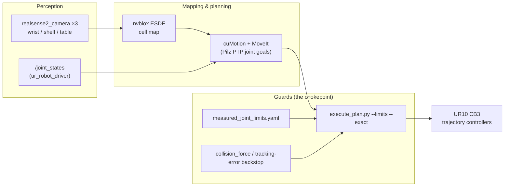
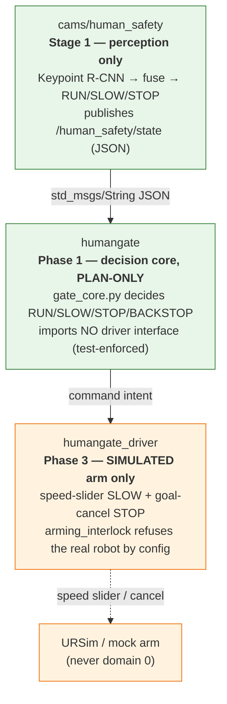

# Architecture & data flow

This page expands the [README "How it works"](../README.md#how-it-works) section with the full
data flow, the ROS domain isolation scheme, and the safety-layering rationale. Every node and
script named here exists in the tree and is linked to its package.

## The single motion authority

The cell is built around one rule: **only the UR driver's trajectory controllers move the real
arm, and they are reached only through `cams/cellmap/tools/execute_plan.py` with limit and
contact guards.** Everything else is upstream of that chokepoint and cannot reach the robot
except through it.

Why this matters: CB3 has no force/torque sensor, so contact is only *estimated* from joint
currents. The effective ROS-side contact guard is **tracking error**, not force; the real
force stop is the pendant's safety-rated Force limit. See `data/collision-force-v1/decision.md`.

## Human-safety layering

Human safety is split into three packages that are each provably unable to touch the real arm,
so the risky driver wiring can be developed and simulated without ever endangering the cell:

- **`cams/human_safety`** publishes but never actuates. Pure decision logic (geometry, tracker,
  `SafetyEvaluator`) is ROS/torch/GPU-free and unit-tested offline; the ROS nodes are thin shells.
  It is the only task permitted to open the cameras, on isolated `ROS_DOMAIN_ID=77`.
- **`humangate`** is the robot-side decision core. `test_no_driver_interface.py` fails the build
  if it ever imports a driver/controller/dashboard interface. Runs on `ROS_DOMAIN_ID=78`.
- **`humangate_driver`** is the only package that may command a (simulated) arm. Its
  `arming_interlock.py` refuses unless `arm:=true`, the domain is not 0/42, and the robot IP is
  loopback/Docker-internal — never `192.168.0.1` / a physical NIC. Runs on `ROS_DOMAIN_ID=79`.

Fail direction is always **toward STOP**: stale input, missing input, or a parse failure all
resolve to STOP, never RUN.

## ROS domain isolation

Each subsystem runs on its own `ROS_DOMAIN_ID` so a simulation or evaluation layer can never
accidentally reach the live cell (which is domain 0). This is the enforced separation:

| Domain | Subsystem | Touches real arm? |
|---|---|---|
| 0 | Live cell: driver, cameras, cuMotion, execute_plan | **Yes** (guarded) |
| 77 | `cams/human_safety` perception | No (cameras only) |
| 78 | `humangate` decision core | No (plan-only) |
| 79 | `humangate_driver` | Simulated arm only |
| 83 | `dynamic_pick` moving-target re-plan | No (sim) |
| 84 | `mpc_curobo` reactive MPC | No (sim/eval) |
| 85 | `cams/cellmap/dynamic` nvblox dynamic layer | No (sim, plan-only) |
| 88 | `sim/isaac_human` Isaac Sim test | No (sim) |

All run with `FASTDDS_BUILTIN_TRANSPORTS=UDPv4`. See `AGENTS.md` for the per-task domain notes.

## Evaluation and simulation layers

These never run on the cell; they exist to validate the real layers:

- **`sim/isaac_human`** — renders a person walking a scripted path around a UR10 stand-in in
  Isaac Sim and feeds the *unchanged* detector+fusion graph, comparing the published safety
  distance against the simulator's true person position. This is how the STOP-ring distance bug
  was caught and the nearest-point fix verified.
- **`dynamic_pick`** — segmented cuMotion re-plan + preempt for a moving pick target, gated by a
  shim that only forwards a goal on a fresh human-gate RUN.
- **`mpc_curobo`** — a cuRobo V2 reactive-MPC prototype in its own CUDA + ROS 2 Humble container,
  streaming to a `forward_position_controller` (which holds its last setpoint if the stream
  starves while the driver is alive).

## Where to read next

| Topic | File |
|---|---|
| Camera bring-up sharp edges | [`cams/README.md`](../cams/README.md) |
| Cell mapping, calibration, execute tooling | [`cams/cellmap/README.md`](../cams/cellmap/README.md) |
| Human-safety perception design | [`cams/human_safety/README.md`](../cams/human_safety/README.md) |
| Robot-side gate | [`humangate/README.md`](../humangate/README.md), [`humangate_driver/README.md`](../humangate_driver/README.md) |
| Isaac Sim test harness | [`sim/isaac_human/README.md`](../sim/isaac_human/README.md) |
| Operator day-to-day | [`RUNBOOK.md`](../RUNBOOK.md) |
